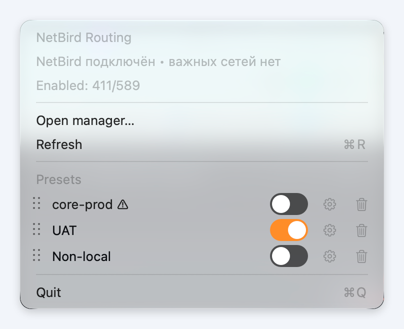

# NetbirdRouting

Утилита для строки меню macOS, управляющая сетями NetBird через локальный CLI.
Не требует API-токена и не заменяет клиент NetBird.

<p align="center">
  
</p>

## Возможности

- Включение и отключение отдельных сетей в окне **Open manager…**.
- Группировка сетей в пресеты с regex-фильтрами по ID, подсети или домену.
- Инверсия фильтра, предпросмотр совпадений, редактирование и перетаскивание пресетов.
- Отметка важных пресетов и восстановление сетей, отключённых пресетом.

Индикатор **R** в строке меню:

| Цвет | Состояние |
| --- | --- |
| Зелёный | NetBird подключён |
| Красный | Подключён и активен хотя бы один важный пресет |
| Серый | NetBird отключён |
| Жёлтый | Ошибка или состояние неизвестно |

## Требования

- macOS 13 или новее, Apple Silicon (`arm64`) либо Intel (`x86_64`).
- Установленный и авторизованный [NetBird](https://netbird.io/).
- CLI с командами `networks list`, `networks select`, `networks deselect` и
  `status --json`. Парсер ориентирован на формат NetBird 0.82.1;
  совместимость с другими версиями нужно проверять отдельно.
- Для сборки из исходников — Xcode Command Line Tools (`xcode-select --install`).

## Готовая сборка

В GitHub откройте **Actions → Build macOS → успешный запуск → Artifacts**.
Выберите `NetbirdRouting-macos-arm64` для Apple Silicon или
`NetbirdRouting-macos-x86_64` для Intel. Артефакт содержит:

- `NetbirdRouting-macos-<arch>-app.zip` — приложение для обычного запуска;
- `NetbirdRouting-macos-<arch>-binary.zip` — отдельный исполняемый файл;
- `SHA256SUMS` — контрольные суммы обоих ZIP.

После распаковки внешнего архива артефакта можно проверить ZIP:

```sh
shasum -a 256 -c SHA256SUMS
```

Распакуйте `*-app.zip`, перенесите `NetbirdRouting.app` в `/Applications`
и запустите. Приложение работает в строке меню, без значка в Dock.

**Сборки подписаны только ad-hoc, без Developer ID и notarization.**
macOS может заблокировать загруженное приложение. Если вы доверяете исходникам
и сборке, разрешите запуск через **Системные настройки → Конфиденциальность
и безопасность**. Не отключайте Gatekeeper целиком.

## Сборка из исходников

```sh
git clone https://github.com/Andrey039/NetbirdRouting.git
cd NetbirdRouting
zsh test.sh
zsh build.sh
open NetbirdRouting.app
```

Результат: `NetbirdRouting.app` и отдельный бинарник `build/NetbirdRouting`
с зелёной **R** в Finder. Собирается архитектура текущего компьютера,
deployment target — macOS 13. Для создания ZIP и контрольных сумм:

```sh
zsh tools/package.sh
```

Архивы появятся в `dist/`. Сторонние Swift-зависимости не нужны.

## Настройка и использование

По умолчанию CLI ожидается в `/usr/local/bin/netbird`.
Если он установлен в другом месте, запустите исполняемый файл с `NETBIRD_BIN`:

```sh
NETBIRD_BIN=/opt/homebrew/bin/netbird ./NetbirdRouting.app/Contents/MacOS/NetbirdRouting
```

Переменные окружения из Terminal не передаются автоматически приложению,
запущенному через Finder.

Откройте **R → Open manager…**, проверьте список сетей и настройте пресеты.
Regex применяется без учёта регистра. Важный пресет окрашивает **R** в красный,
если хотя бы одна подходящая сеть включена. Переключатели меняют реальные
маршруты NetBird: перед отключением убедитесь, что не потеряете нужный доступ.

Пресеты хранятся в
`~/Library/Application Support/NetbirdRouting/presets.json`,
состояние восстановления — в `UserDefaults`. Эти данные могут содержать
внутренние имена и ID сетей: не добавляйте их в репозиторий или публичные issue.

Дополнительные CLI-команды:

```sh
# Добавить или обновить пресет; regex заключайте в одинарные кавычки.
./build/NetbirdRouting --preset-add Example '^example-' --high-importance
./build/NetbirdRouting --preset-add Other '^example-' invert

# Показать сводку и до 30 включённых сетей (может содержать приватные данные).
./build/NetbirdRouting --dump
```

После изменения пресетов через CLI выберите **Refresh** в меню.

## Как создавать пресеты

Пресет — сохранённый фильтр сетей, а не отдельное подключение NetBird.

1. Откройте **R → Open manager…**.
2. Введите выражение в **Regex filter**. Список покажет подходящие сети.
3. При необходимости включите **Invert**, чтобы выбрать всё, что **не** подходит
   под выражение.
4. Нажмите **Save preset…**, задайте имя и проверьте regex и флажок **Invert**.
   Предпросмотр показывает число совпавших и включённых сетей, а также примеры ID.
5. При необходимости отметьте **Высокая важность**, затем нажмите **Save**.

Пресет появится в меню **R → Presets**. Шестерёнка открывает настройки,
корзина удаляет пресет, точки слева позволяют менять порядок перетаскиванием.

### Примеры фильтров

В UI вводите regex как есть, **без кавычек** и без обрамления `/…/`.
Регистр не учитывается; совпадение ищется в любой части строки.

| Задача | Regex | Invert |
| --- | --- | --- |
| ID начинается с `core-prod` | `^core-prod` | Выключен |
| ID точно равен `uat` | `^uat$` | Выключен |
| Подсеть начинается с `10.20.` | `^10\.20\.` | Выключен |
| Встречается домен `example.test` | `example\.test` | Выключен |
| Всё, кроме сетей с `prod` в ID или описании | `prod` | **Включён** |

Несколько вариантов объединяются через `|`. Например, `prod` **или** `uat`:

```regex
prod|uat
```

Точка `.` в regex означает любой символ. Для буквальной точки используйте `\.`;
`^` — начало строки, `$` — конец.

### Отрицание: «всё, кроме…»

**Рекомендуемый способ — положительный regex + Invert.**
Чтобы выбрать всё, кроме production и UAT, задайте:

```text
Regex:  prod|uat
Invert: включён
```

Фильтр проверяет **два поля отдельно**: ID и информацию о сети (подсеть/домены).
Обычный режим выбирает сеть, если совпало **хотя бы одно** поле.
**Invert** выбирает её, только если **ни одно** поле не совпало.
Поэтому сеть с ID `office` и доменом `prod.example.test` будет исключена.

Пример **Non-local** — исключение строк, начинающихся с приватных IPv4-диапазонов:

```regex
^(10\.|192\.168\.|172\.(1[6-9]|2[0-9]|3[01])\.)
```

Включите **Invert** и проверьте предпросмотр. Это текстовый фильтр,
**не анализ CIDR или доступности**: IPv6, CGNAT `100.64.0.0/10` и ресурсы,
заданные доменами, этот пример не исключает сам по себе.

Через CLI тот же пресет создаётся так:

```sh
./build/NetbirdRouting --preset-add Non-local \
  '^(10\.|192\.168\.|172\.(1[6-9]|2[0-9]|3[01])\.)' invert
```

**Почему не просто отрицательный regex?** Выражение `^(?!.*prod).*$`
означает «строка не содержит `prod`», но применяется к каждому полю отдельно.
Если ID — `core-prod`, а подсеть — `10.20.0.0/16`, подсеть совпадёт
с отрицательным выражением, и сеть всё равно попадёт в выборку.
Для исключения сети целиком используйте `prod` + **Invert**, а не negative lookahead.
Сочетание отрицательного regex и **Invert** не нужно для обычного «всё, кроме».

### Что делает переключатель пресета

- **Выключение** отключает подходящие сети, которые сейчас включены,
  и запоминает их ID.
- **Включение** восстанавливает запомненные сети. Если сохранённого списка нет,
  включает все сети, подходящие под фильтр.
- Переключатель считается включённым, если включена **хотя бы одна** сеть пресета;
  это не означает, что включены все совпавшие сети.

Перед переключением проверьте предпросмотр, особенно с **Invert**:
широкий фильтр может затронуть доступ к рабочей инфраструктуре.

## Тесты и CI

```sh
zsh test.sh
```

Тесты используют фикстуры, mock CLI и временное хранилище.
Они не требуют установленного NetBird и не меняют реальные сети.

[GitHub Actions](.github/workflows/build.yml) запускает тесты, сборку,
проверку подписи и упаковку на Apple Silicon и Intel **только при push тега `v*`**
(например, `v1.0.0`). Push ветки и pull request сборку не запускают.
Артефакты хранятся 14 дней;
workflow не создаёт GitHub Release. Сертификаты и repository secrets не нужны.
Отдельный CI job проверяет доступную Git-историю и рабочее дерево с помощью
Gitleaks; автоматическое сканирование не заменяет проверку изменений перед commit.

## Структура проекта

- `Sources/` — рабочий Swift/AppKit-код.
- `Tests/` — тесты.
- `tools/` — генерация иконки и упаковка.

Приложение не устанавливает root-демон и не переопределяет DNS.
Проект не является официальным клиентом NetBird.
